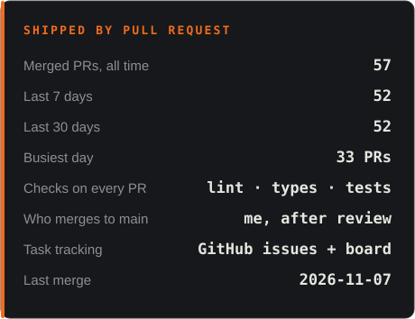
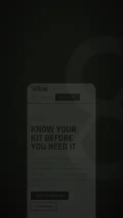

## Hello there.

I'm Chris Grimsley, a software developer and Air Force veteran. I'm building
**[Silkie](https://silkie.io)**, one place for your kit, your people and your
events.

The people who keep gear ready (preppers, training groups, homesteaders, ham
radio folks, medics, ruckers, airsofters) are split across a dozen apps and a
hundred small corners of the internet. The group chat is on Discord, the packing
list is in a notes app, and the training day is a Facebook event. Silkie pulls
that into one place so the community can find each other, for everyone's
benefit. The basics are free and stay free. Premium helps keep it running.

React 19 and Django 5, live in beta at **[silkie.io](https://silkie.io)**.

Background, work history and what else I'm building:
**[christopher-grimsley.com](https://christopher-grimsley.com/)**.

  

---

## 🧭 What's in it now

**A new look.** The whole app was redrawn in November 2026: a field-paperwork
style in signal green and blaze orange, with light and dark themes and the new
S-biner logo (the S is a carabiner).

**Your kit.** Inventory down to the item, packing lists you can repeat, SOPs that
export to PDF, a training log, monthly challenges, and a monthly bag check that reminds you to open the go-bag, swap
what's expired and charge the batteries.

**Your people.** Tribe Finder helps you find groups and people who train like you
do. When both sides want to meet, you *link up*. Members get profiles with a
wall, earned badges, vouches from people they've trained with, Rep, and stories
that show up as a ring on their picture. The home timeline has For you,
Following, and Groups and events tabs.

**Your events.** Register, get a pass, and check in at the door. Organizers see
who came, check-ins count toward badges and vouches, organizers apply to run
events, and members can report a bad one.

**Talking.** A two-pane inbox for messages, with direct messages end-to-end
encrypted by default and safety codes you can compare. A public forum, readable
without an account, that syncs both ways with the
**[Silkie Discord](https://discord.gg/uqcJQnWrgx)**. Notifications group by
conversation, with switches for what you want to hear about.

**Safety.** A "view as" mode to see your profile the way other members do, a
profile check that flags things you may not want to share, a quiet mode, and
location data stripped from new photos. These stay free for everyone.

**Running it.** Volunteer staff can apply, get reviewed and onboard (or step
down) from inside the app. A metrics dashboard gives me the numbers I need
without exposing anyone: small groups are hidden from every export.

---

## 📦 Shipping log

Most recent first, taken from merged pull requests.

| Date | Area | What changed |
| :--- | :--- | :--- |
| `2026-11-06` | Messages | Safety codes for encrypted chats, an encryption panel, and location stripped from new photos |
| `2026-11-06` | Community | Volunteer staff: apply, review, onboard, step down |
| `2026-11-06` | Insights | Metrics dashboard with privacy-safe reports |
| `2026-11-06` | Creators | Invite links that give partner communities free lifetime Premium |
| `2026-11-06` | Discord | Get started panel, event tickets and Discord Scheduled Events in the bot |
| `2026-11-06` | Forum | Removed replies stay in place and show when they were removed |
| `2026-11-06` | Messages | Two-pane inbox with the chat list beside the open chat |
| `2026-11-06` | Tribe Finder | Link up with a carabiner replaces hearts and "match" |
| `2026-11-06` | Events | Registration, tickets and door check-in |
| `2026-11-06` | Stories | Stories with rings on avatars, plus kit and event cards |
| `2026-11-06` | Kit | Monthly bag check, training log, monthly challenges and a light/dark switch |
| `2026-11-06` | Safety | View as, profile check, quiet mode and event check-ins |
| `2026-11-06` | Profiles | Vouches, Copy this kit, @handles and Rep |
| `2026-11-06` | Profiles | Notifications page, edit profile, profile layouts and earned badges |
| `2026-11-06` | Home | Home timeline: For you, Following, Groups and events |
| `2026-11-06` | Profiles | Member profiles and walls with posts, votes, comments and reports |
| `2026-11-06` | Forum | Built-in forum with two-way Discord sync |
| `2026-11-05` | Messages | End-to-end encrypted direct messages, on by default |
| `2026-11-05` | Design | New look across the whole app, light and dark |
| `2026-11-05` | Discord | Community Discord and Silas, its setup and support bot |
| `2026-11-05` | Build | Moved to the new claude-loop build harness, CI green on main |

---

## 📊 By the numbers

---

## 🔁 How it gets built

Silkie has a second contributor: **claude-loop**, a small harness that runs
Claude Code against the repo from my PC.

GitHub issues are the queue. A steward loop checks in every ten minutes, picks
up issues marked ready, and hands each one to a worker agent on its own branch.
The worker opens a pull request, CI runs lint, type checks, tests and the build,
and nothing reaches `main` until it's green and I've merged it. An audit pass
looks for problems and proposes new issues, but nothing gets queued until I
approve it. Progress lands on a GitHub project board and as status cards in the
Discord.

Most of the November redesign came from working through features in
conversation, with every change landing as a reviewed pull request.

---

## 🎬 See it

<table>
<tr><td align="center" valign="top"> <b>Tour</b></td><td align="center" valign="top"> <b>Tribe Finder</b></td><td align="center" valign="top"> <b>Profiles</b></td><td align="center" valign="top"> <b>Feed</b></td></tr>
</table>

---

## 🧰 Built with

---

<table>
<tr>
<td width="180" valign="middle">

</td>
<td valign="middle">

### Try it

Point a camera at that, or go to **[silkie.io](https://silkie.io)**. It's free
to join, and the first 100 members get Founder Premium for life.

Come say hi on **[Discord](https://discord.gg/uqcJQnWrgx)**, or write to
**[support@silkie.io](mailto:support@silkie.io)** with questions and bug reports.

Development progress in public: **[silkie_public_progress](https://github.com/CGGrimsley/silkie_public_progress)**

</td>
</tr>
</table>

---

#### About this page

The Silkie code is in a private repo. This page used to be rebuilt every night
by a script in the old harness. That harness has been retired, so the page is
now written by hand from merged pull requests, and it only describes features
that are live on the site.

Last updated 2026-11-07
