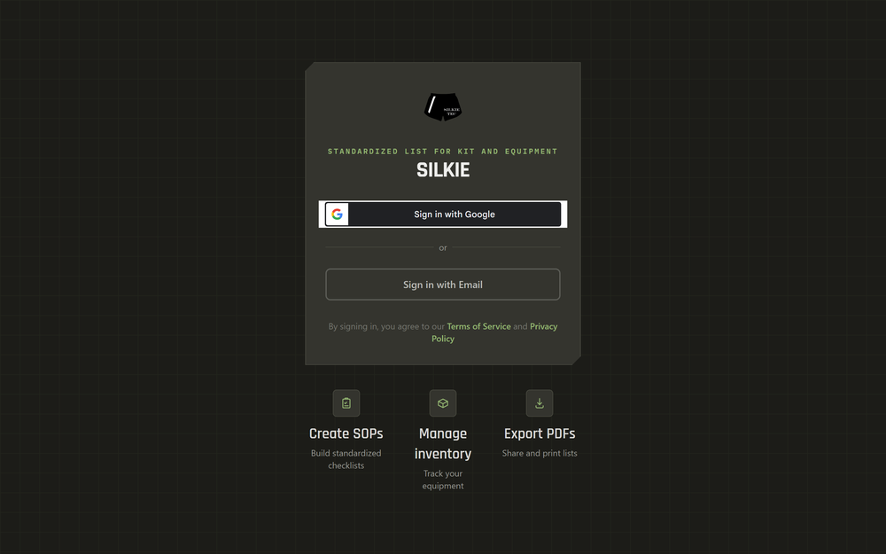

## Hello there.

I'm Chris Grimsley. Building SiLKiE — inventory, loadouts and SOPs for people who keep gear ready.

It's inventory tracking, repeatable loadout checklists and SOP documents in one
place — for shooters, campers, and anyone whose packing list currently lives
across four notes apps. React 19 and Django 5, running at
**[silkie.io](https://silkie.io)**.

The code is in a private repo, so this page is generated rather than written. A
script reads the local git history and task queue each night, drops what
shouldn't be public, and rewrites this file. There's a note at the bottom on how
it decides.

---

## 📦 Shipping log

Most recent first. `×N` means a run of commits that collapsed to one line.

| Date | Area | What changed |
| :--- | :--- | :--- |
| `2026-08-25` | Repo | Untrack the autonomous harness from the app repo |
| `2026-08-25` | Backend | Register WeasyPrint DLL dir so PDF tests run on Windows |
| `2026-08-25` | Harness | Fix |
| `2026-08-25` | Frontend | Fix |
| `2026-08-25` | Inventory | Fix |
| `2026-08-25` | Ad Studio | New work |
| `2026-08-24` | Ad Studio | Move Ad Studio into its own switchable top-level tab |
| `2026-08-24` | Ad Studio | Local ad creative generator + dashboard integration |
| `2026-08-24` | Frontend | New work ×7 |
| `2026-08-24` | Accounts | Crop profile photos to a circle-filling square |
| `2026-08-24` | Community | Clip swipe-out card so it can't push the page sideways on mobile |
| `2026-08-24` | Backend | Enrich tribe finder + event demo data for local testing |
| `2026-08-24` | Frontend | Guarantee app preloader removal with timeout fallback |
| `2026-08-24` | SOP builder | Import WeasyPrint lazily so backend boots without GTK |

Recently in: **Frontend** (9) · **Ad Studio** (3) · **Backend** (2) · **Repo** (1) · **Harness** (1) · **Inventory** (1)

> 5 of the rows above show a generic summary instead of the real
> commit subject — the filter drops any subject carrying a file path, a line
> number, or hardening language.

---

## 📊 By the numbers

| | |
| :--- | ---: |
| Commits, all time | **448** |
| Last 7 days | **344** |
| Last 30 days | **389** |
| Days with a commit | **8** |
| Current streak | **2 days** |
| Longest streak | **3 days** |
| Tasks completed | **65** |
| Still queued | **0** |
| Test files | **55** (42 frontend, 13 backend) |
| Building since | **2025-12** |

| Language | | |
| :--- | :--- | ---: |
| TypeScript | `████████████░░░░░░░░░░` | 56.5% |
| Python | `█████████░░░░░░░░░░░░░` | 41.6% |
| CSS | `█░░░░░░░░░░░░░░░░░░░░░` | 1.1% |
| HTML | `█░░░░░░░░░░░░░░░░░░░░░` | 0.6% |
| JavaScript | `█░░░░░░░░░░░░░░░░░░░░░` | 0.1% |

---

## 🤖 The night shift

SiLKiE has a second contributor: an autonomous Claude Code harness that runs
between 00:00 and 08:00 and is not allowed to touch anything outside that window.

It works one task per cycle. A runner script — never the model — owns git and the
queue: it claims the top task, cuts an `ai-dev-*` branch, dispatches a worker
agent that may only edit files, then runs the real gates (`tsc`, `eslint`,
`vitest`, `vite build`, `ruff`, `pytest`) against whatever came back. Green
merges to the dev branch and the task is marked done. Red marks it blocked, keeps
the branch, and moves on. `main` is read-only to every agent, enforced by a shell
hook rather than a promise in a prompt.

| | |
| :--- | ---: |
| Autonomous cycles | **81** |
| Nights run | **2** |
| Tasks shipped unattended | **75** |
| Machine hours | **7.4** |
| Last run | **2026-08-26** |

Audits run separately and read-only: security, performance, mobile, feature
completeness and compliance sweeps each file their findings back into the queue
as tasks instead of editing anything themselves.

---

## 🎬 See it

<table>
<tr>
<td width="320" valign="top">

</td>
<td valign="top">

</td>
</tr>
</table>

---

## 🧰 Built with

---

<table>
<tr>
<td width="180" valign="middle">

</td>
<td valign="middle">

### Try it

Point a camera at that, or go to **[silkie.io](https://silkie.io)**.
Questions, bug reports, or you want in on the beta — **[support@silkie.io](mailto:support@silkie.io)**.

Development progress in public: **[silkie_public_progress](https://github.com/CGGrimsley/silkie_public_progress)**

</td>
</tr>
</table>

---

#### About this page

A Python script in the private SiLKiE repo builds this file nightly from local
git and the task queue. It is allow-first: a commit subject is published only if
it is plain prose with no path, no line reference, no internal task id and no
hardening vocabulary. Everything else becomes the generic line you see above.
Task text, branch names, spend and file paths never leave the machine.

A false positive there costs a dull row and a false negative costs a leak, so it
fails closed.

Last generated 2026-08-26 04:07 UTC · latest commit 2026-08-25
